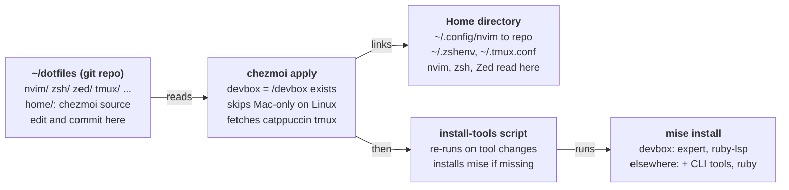

# Dotfiles setup guide

## Overview

All config lives in `~/dotfiles`, and your home directory only holds symlinks into it. chezmoi creates those symlinks and knows which machine it is on. mise installs the tools. Edit a config in place, commit it, and every machine picks it up on its next `chezmoi apply`.

The moving parts:

- **chezmoi**: creates the symlinks, skips Mac-only configs on Linux, fetches the catppuccin tmux theme, and runs the tool install script.
- **mise**: installs CLI tools and the two language servers. It replaces asdf.
- **zsh**: shell config, split into env, rc, aliases and completions.
- **Neovim**: lazy.nvim plugin setup, native LSP, treesitter on its `main` branch.
- **Zed**: its own settings and keymap. Neovim's keys follow Zed's for the actions both have.
- **dotbot**: the old installer. It still works and creates the same links, until you remove it.



You edit and commit in the repo. `chezmoi apply` keeps the home directory's links in step, and re-runs the tool install whenever the mise list changes.

### Repo layout

| Path | What it is | Linked to |
| --- | --- | --- |
| `home/` | chezmoi's source: symlink entries, templates, the install script | (read by chezmoi) |
| `.chezmoiroot` | Tells chezmoi to look only in `home/` | — |
| `nvim/` | Neovim config | `~/.config/nvim` |
| `zsh/` | `zshenv.zsh`, `zshrc.zsh`, `aliases.zsh`, `completions.zsh`, `plugins/` | `~/.zshenv`, `~/.config/zsh/*` |
| `zed/` | `settings.json`, `keymap.json` | `~/.config/zed/*` |
| `tmux/tmux.conf` | tmux config | `~/.tmux.conf` |
| `gitconfig`, `.work.gitconfig` | git config; the work one is used under `~/projects/barsoom/` | `~/.gitconfig`, `~/.work.gitconfig` |
| `bat/`, `lsd.yaml`, `ghostty/`, `.ripgreprc` | Small tool configs | `~/.config/...`, `~/.ripgreprc` |
| `ruby/default-gems` | Gems mise installs into every new Ruby (ruby-lsp) | `~/.default-gems`, not on the devbox |
| `kitty/`, `.wezterm.lua`, `.aerospace.toml`, `.obsidian.vimrc` | Mac-only configs | Linked only on macOS |
| `dotbot/`, `install`, `install.conf.yaml` | Legacy installer | — |

## Machine types

There are two machine types, decided once by whether `/devbox` exists. chezmoi works this out in `home/.chezmoi.toml.tmpl` when you run `chezmoi init`, and stores it as `devbox = true/false` in `~/.config/chezmoi/chezmoi.toml`. Check it with `chezmoi data | grep devbox`.

| | Devbox (work, Linux) | Everything else (Mac, plain Linux) |
| --- | --- | --- |
| CLI tools (nvim, rg, bat, delta, lsd, starship, zoxide, tree-sitter) | Devbox binwrappers in `/devbox/tmp/devbox/binwrappers` | mise |
| expert | mise | mise |
| ruby-lsp | mise (`gem:ruby-lsp`) | Installed into each mise Ruby from `~/.default-gems` |
| Ruby | Devbox binwrapper | mise: `latest`, or the project's `.ruby-version` |
| Mac-only configs (kitty, wezterm, aerospace, raycast, obsidian) | Skipped | Linked on macOS only |
| Clipboard in Neovim | OSC 52 copy through the terminal, paste from nvim's own register | System clipboard |
| zsh extras | Sources the devbox profile, broot and shadowenv, sets `DEV_HOST=devbox` | Homebrew paths on macOS |

Three places check for the devbox, each for a different moment:

- **chezmoi** (`/devbox` exists): decides what gets installed and linked.
- **zsh** (`$DEVBOX` is set): decides what each shell loads.
- **Neovim** (`vim.g.is_devbox`, from `$DEVBOX == "true"`): the clipboard setup and lazy.nvim's local plugin path.

The devbox sets `$DEVBOX` itself, so you never set it by hand.

## chezmoi

chezmoi only reads `home/`, and almost every file there is a one-line symlink entry. For example, `home/private_dot_config/symlink_nvim.tmpl` contains `{{ .chezmoi.workingTree }}/nvim`, which becomes the symlink `~/.config/nvim → ~/dotfiles/nvim`. Because they're symlinks, editing a config through `~/.config/...` edits the repo directly.

### How names map to paths

| In `home/` | Becomes |
| --- | --- |
| `dot_` prefix | A leading `.` (`dot_config` → `.config`) |
| `private_` prefix | Permissions 700 (`private_dot_config` keeps `~/.config` private) |
| `symlink_` prefix | A symlink. The file's content is the link target. |
| `.tmpl` suffix | Rendered as a Go template first (`{{ if .devbox }}`, `{{ .chezmoi.os }}`) |
| `run_onchange_after_` prefix | A script, run after files are written, and re-run only when its rendered content changes |

### Special files

- **`.chezmoi.toml.tmpl`**: detects the devbox and points chezmoi at `~/dotfiles`.
- **`.chezmoiignore`**: skips the Mac-only configs when the OS isn't `darwin`.
- **`.chezmoiexternal.toml`**: downloads catppuccin tmux v2.1.1 into `~/.config/tmux/plugins/catppuccin/tmux`.
- **`private_dot_config/mise/config.toml.tmpl`**: the tool list. It's written as a real file, not a symlink, because it differs per machine.
- **`run_onchange_after_install-tools.sh.tmpl`**: installs mise if it's missing and runs `mise install`. A hash of the rendered mise config sits in a comment, so the script re-runs only when the tool list changes.

### Daily workflow

1. Edit any config normally, for example `nvim ~/.config/nvim/...` or `zcfg`. You're editing the repo.
2. Commit and push from `~/dotfiles`.
3. On other machines, run `git -C ~/dotfiles pull && chezmoi apply`. Or run `chezmoi update`, which does both.

Useful commands:

- `chezmoi diff`: what `apply` would change.
- `chezmoi apply -v`: apply and list each change.
- `chezmoi managed`: everything chezmoi controls.
- `chezmoi doctor`: check the install.

### Adding a new config

Say you want to link `~/dotfiles/foo/config.toml` to `~/.config/foo/config.toml`:

1. Put the file in the repo, in a tool folder.
2. Create `home/private_dot_config/foo/symlink_config.toml.tmpl` containing `{{ .chezmoi.workingTree }}/foo/config.toml`.
3. Mac only? Add `.config/foo` to the `{{ if ne .chezmoi.os "darwin" }}` block in `home/.chezmoiignore`.
4. Run `chezmoi apply`.

To link a whole folder, use the folder as the target, as with `symlink_nvim.tmpl`.

## mise

mise installs every tool listed in `home/private_dot_config/mise/config.toml.tmpl`. chezmoi writes the rendered result to `~/.config/mise/config.toml`. zsh runs `mise activate zsh` when mise is installed, which puts those tools first in PATH. Without mise, zsh falls back to the asdf shims (non-devbox machines only).

| Tool | Installed on | Version |
| --- | --- | --- |
| neovim, tree-sitter, ripgrep, bat, delta, lsd, fzf, starship, zoxide | Non-devbox machines | `latest` |
| expert (Elixir LSP), from `github:elixir-lang/expert` | All machines | `latest` |
| ruby-lsp, from `gem:ruby-lsp` | Devbox | `0.26`. `latest` picks gem prereleases, so it's pinned to the stable series. |
| ruby | Non-devbox machines | `latest` as the default. macOS's system Ruby (2.6) is too old for ruby-lsp. |
| ruby-lsp, from `~/.default-gems` | Non-devbox machines | Newest stable. mise runs `gem install` for each line of `ruby/default-gems` whenever it installs a Ruby. |

mise also reads a project's `.tool-versions` and `mise.toml`, so per-project Ruby, Elixir or Node versions keep working as they did with asdf. On non-devbox machines it reads `.ruby-version` too (`idiomatic_version_file_enable_tools` in the mise config), so `cd` into a project and run `mise install` to get its Ruby.

### Adding, removing or pinning a tool

1. Edit `home/private_dot_config/mise/config.toml.tmpl`. Inside the `{{- if not .devbox }}` block, the tool is skipped on the devbox. Outside it, every machine gets it.
2. Use a registry name (`jq = "latest"`) or a backend (`"github:owner/repo"`, `"gem:name"`, `"npm:name"`). Pin with a prefix like `"1.7"` or an exact version.
3. Run `chezmoi apply`. The rendered config changes, so the install script runs `mise install` by itself.

Other commands: `mise ls` shows what's installed and active, `mise upgrade` updates tools pinned to `latest` or a prefix, and `mise doctor` checks the setup.

### Language servers

Neovim and Zed use the same servers: expert for Elixir and ruby-lsp for Ruby. Both are on PATH through mise, so nvim starts them by name from `servers.lua`. ruby-lsp has to run on the project's own Ruby, because it runs bundler against the project's Gemfile. mise's `gem:` backend ties a gem to the Ruby it was installed with, so outside the devbox ruby-lsp is installed into every mise Ruby instead, and PATH finds the copy for the project's Ruby. On the devbox it's the `gem:ruby-lsp` install, which works as long as the project uses the binwrapper Ruby it was installed with.

## zsh

zsh reads `~/.zshenv` first, which sets `ZDOTDIR=~/.config/zsh`. Everything after that is read from `ZDOTDIR`. Nested shells (tmux panes, subshells) inherit `ZDOTDIR` and read `~/.config/zsh/.zshenv` instead, so both paths link to the same `zsh/zshenv.zsh`.

### Startup order

1. **`zshenv.zsh`** (every shell, interactive or not): XDG paths, `ZDOTDIR`, history settings, `EDITOR=nvim`, and `skip_global_compinit=1` so Ubuntu's `/etc/zsh/zshrc` doesn't run its own compinit.
2. **`zshrc.zsh`** (interactive shells), in this order:
    1. Sets `typeset -U path` (no duplicate entries), adds `~/.local/bin` and `~/.cargo/bin`, plus openjdk on macOS.
    2. Sources `aliases.zsh`.
    3. Sources the devbox profile, if it exists.
    4. Sources `~/.env`, if it exists. Use it for machine-local secrets; it isn't in the repo.
    5. On the devbox: broot, shadowenv, `DEV_HOST`. On macOS: `/opt/homebrew/bin`.
    6. Activates mise, or falls back to the asdf shims on non-devbox machines.
    7. Initialises starship and zoxide (`cd` is zoxide).
    8. Sources `completions.zsh`, then fzf (through `~/.fzf.zsh` if present, otherwise `fzf --zsh`).
    9. Adds Homebrew postgres on macOS, sources `~/.zprofile` if it exists, and adds pnpm to PATH.

### Files

| File | Holds |
| --- | --- |
| `zsh/zshenv.zsh` | Environment only. Keep it fast; it runs for every shell and script. |
| `zsh/zshrc.zsh` | Interactive setup: PATH, tool init, the order above |
| `zsh/aliases.zsh` | Aliases and small functions: `gst`, `cat` = `bat`, `ls` = `lsd`, `dot`, `zso` (reload), `zcfg` (edit), `ksh`, `unlock_devbox`, `miex` |
| `zsh/completions.zsh` | compinit, menu selection with hjkl, matching rules, completion styles |
| `zsh/plugins/cursor_mode.zsh` | Cursor shape helper |

### Completions

`completions.zsh` runs compinit once per shell. Once a day it does the full security check and refreshes `~/.config/zsh/.zcompdump`. The rest of the time it runs `compinit -C`, which reuses the dump and is much faster. After installing a tool that ships new completions, run `rm ~/.config/zsh/.zcompdump && exec zsh` to see them right away. The devbox profile still runs one compinit of its own; that's outside these dotfiles.

## Neovim

Neovim 0.12+ with lazy.nvim. Each plugin's settings live in its own file under `lua/oddnugget/plugins/`, and `nvim/lazy-lock.json` is committed so plugin versions are pinned. Undo a bad update with `git checkout nvim/lazy-lock.json` and then `:Lazy restore`.

### Layout

| File | Holds |
| --- | --- |
| `init.lua` | Sets `vim.g.is_devbox`, loads autocmds, options and lazy, and loads keymaps on `VeryLazy` |
| `filetype.lua` | Extra filetype rules (jsonc, Brewfile, mdx, puml) |
| `lua/oddnugget/config/options.lua` | Options, leader keys (`<Space>`, `,`), and the devbox OSC 52 clipboard |
| `lua/oddnugget/config/keymaps.lua` | General keymaps (not tied to a plugin) |
| `lua/oddnugget/config/autocmds.lua` | `q` closes helper windows, yank highlight, cursorline only in the active window, search highlight only while searching |
| `lua/oddnugget/config/lazy.lua` | lazy.nvim bootstrap. The update checker runs without notifications. |
| `lua/oddnugget/plugins/*.lua` | One file per plugin area |
| `lua/oddnugget/servers.lua` | Language server list and per-server settings |
| `after/ftplugin/*.lua` | Per-filetype tweaks (sql, rust, markdown, json, gdscript, oil) |

### Treesitter

nvim-treesitter is on the `main` branch. Highlighting and indent come from Neovim itself, and the plugin only installs parsers. On startup it installs any missing parser from the list in `plugins/treesitter.lua`. Parsers are built with the `tree-sitter` CLI (0.26.1 or later) into `~/.config/local/share/nvim/site/parser/`. Use `:TSUpdate` to rebuild them and `:checkhealth nvim-treesitter` to check them. For a new language, add it to the `parsers` list.

### LSP and formatting

Servers use Neovim's native `vim.lsp.config` / `vim.lsp.enable`, with defaults from nvim-lspconfig. `servers.lua` holds only the overrides. To add a server, add `name = { ... }` to `M.list`, using the name from nvim-lspconfig's `lsp/` folder. Keymaps are set per buffer in an `LspAttach` autocmd. conform.nvim formats on save, but only in buffers that have an LSP client attached. Formatters are set per filetype in `plugins/lsp.lua`, with LSP formatting as the fallback.

Active servers: astro, taplo, bashls, lua_ls, basedpyright, ts_ls, dockerls, cssls, emmet_ls, html, expert, ruby_lsp, plus lexical when `NVIM_LEXICAL_PATH` is set. rustaceanvim handles Rust on its own. elixir-tools stays loaded with its LSP turned off, only for its Phoenix alternate-file rules behind `:A`.

### Plugins

| Area | Plugins |
| --- | --- |
| Core | lazy.nvim, snacks.nvim (picker, dashboard, notifier, indent, scope, scroll, words), which-key |
| Editing | blink.cmp + friendly-snippets, nvim-autopairs, nvim-surround, vim-sleuth, built-in `gc` comments |
| Navigation | oil.nvim, harpoon (harpoon2), vim-tmux-navigator, vim-projectionist |
| Search | snacks picker, grug-far.nvim (find and replace) |
| Code | nvim-treesitter + textobjects, nvim-lspconfig, conform.nvim, lazydev, rustaceanvim, elixir-tools (projections only), vim-slim |
| Git | vim-fugitive, diffview.nvim, snacks git pickers |
| UI | catppuccin (macchiato), lualine (statusline, winbar, LSP progress), mini.icons |
| Misc | vim-slime (tmux target) |

## Keybinds

Where Neovim and Zed both have an action, nvim uses Zed's vim-mode key, so the same key works in both editors. Zed's keymap wasn't changed. `<leader>` is Space. Press `<leader>?` in nvim to see the current buffer's maps.

### Same key in both editors

| Action | Key | Notes |
| --- | --- | --- |
| Go to definition | `gd` | |
| References | `gA` | |
| Diagnostics or hover | `gh` | nvim shows the line's diagnostics if there are any, otherwise hover |
| Code action | `g.` | |
| Symbols in file | `gs` | |
| Next / previous function | `]m` / `[m` | |
| Project find and replace | `g/` | nvim opens grug-far in a left split |
| Next / previous diagnostic | `]d` / `[d` | Built into both |
| Move between panes | `Ctrl-h/j/k/l` | Also moves between tmux panes in the terminal |
| Find files | `<leader>ff` | |
| Search the project | `<leader>fw` | |
| File explorer | `<leader>e` | oil in nvim, the project panel in Zed |
| Copy relative path | `<leader>uf` | |
| Yank to end of line | `Y` | |
| Keep selection after indenting | `>` / `<` in visual mode | |

### nvim only (no equivalent in Zed)

| Key | Action |
| --- | --- |
| `gK` | Signature help |
| `<leader>rt` | Run code lens |
| `<leader>fm` | Format the buffer |
| `<leader>f<leader>` | Resume the last picker |
| `<leader>fb` / `<leader>fr` | Buffers / recent files |
| `<leader>gw` | Grep the word under the cursor |
| `<leader>sb` / `<leader>sB` | Buffer lines / grep open buffers |
| `<leader>sd` / `<leader>sD` | Diagnostics, project / buffer |
| `<leader>sh` / `<leader>sc` / `<leader>sC` / `<leader>s/` | Help, command history, commands, search history |
| `<leader>gb` / `gl` / `gL` / `gs` / `gS` / `gd` / `gf` (all after `<leader>`) | Git branches, log, log for the line, status, stash, diff hunks, log for the file |
| `<leader>hh` / `<leader>ha` | Harpoon menu / add the current file |
| `<leader><leader>1`…`5` | Jump to harpoon file 1–5 |
| `<leader>tt` / `tn` / `tp` / `tq` | New, next, previous, close tab |
| `<leader>i` / `<leader>o` | Next / previous buffer |
| `<leader>cn` / `<leader>cp` | Next / previous quickfix item |
| `gpi` / `gni` | Jump to the top / bottom of the current scope |
| `Shift-arrows` | Resize the window |
| `q` | Close help, quickfix, fugitive, grug-far and similar windows |
| `gc` | Toggle comment (built in) |

`grr`, `grn`, `gra` and `gri` are Neovim's built-in LSP maps. They still work alongside the Zed-style keys.

## Setting up a machine

### A new machine

One command clones the repo, detects the machine type, links everything and installs the tools:

```
sh -c "$(curl -fsLS get.chezmoi.io)" -- init --apply oddnugget
```

This clones into chezmoi's default location. To keep the repo at `~/dotfiles` like the other machines, clone it there first and run `chezmoi init --apply --source ~/dotfiles`. Before you start, install zsh, git, tmux 3.2 or later, and a C compiler (for treesitter parsers). On a Mac, Homebrew covers those.

After the first apply:

1. Open a new shell and check `mise ls` and `which nvim expert ruby-lsp`.
2. Open nvim. lazy.nvim installs the plugins, and treesitter builds the parsers.
3. Run `:checkhealth vim.lsp nvim-treesitter`.

### Switching this machine from dotbot

1. Install chezmoi, for example with `sh -c "$(curl -fsLS get.chezmoi.io)" -- -b ~/.local/bin`.
   Without `-b`, the installer puts chezmoi in `./bin` under whatever directory you run it from.
2. Run `chezmoi init --apply --source ~/dotfiles`, with no `oddnugget` argument. With a repo argument, chezmoi clones a second copy into its default location and links everything to that copy instead. It replaces dotbot's symlinks with identical ones, adds `~/.config/zsh/.zshenv`, installs mise, and installs expert and ruby-lsp.
3. Open a new shell and check `which expert ruby-lsp`. Then open an Elixir and a Ruby file in nvim.
4. Once both machines work, remove dotbot: `git rm -r dotbot install install.conf.yaml .gitmodules`, then delete the dotbot section from the README.

### On the Mac specifically

The first apply installs the full CLI tool list through mise, and those copies come before Homebrew in PATH. Once you've confirmed they work, uninstall the Homebrew duplicates (`brew uninstall ripgrep bat git-delta lsd fzf starship zoxide neovim tree-sitter`) and remove asdf.

## Troubleshooting

| Symptom | Cause | Fix |
| --- | --- | --- |
| `attempt to call method 'range' (a nil value)` from the treesitter highlighter | Old `master`-branch parsers or code still in use | Quit nvim completely, `rm -rf ~/.config/local/share/nvim/lazy/nvim-treesitter/{parser,parser-info}`, restart, run `:TSUpdate` |
| `:TSUpdate` fails with `mv: cannot stat tree-sitter-*-master` | The nvim session still had the old plugin code loaded after `:Lazy sync` | Quit nvim, delete `~/.config/local/share/nvim/tree-sitter-*`, restart, run `:TSUpdate` |
| Parser build fails | `tree-sitter` CLI missing or older than 0.26.1 | `tree-sitter --version`. Install it with mise (non-devbox) or check the devbox binwrapper. |
| No LSP in Elixir or Ruby files | `expert` / `ruby-lsp` not on PATH | `which expert ruby-lsp`, `mise ls`, `chezmoi apply`, then open a new shell |
| Two clients for the same server | Something else also starts it (for example a plugin) | `:checkhealth vim.lsp` shows the clients. Remove the duplicate source. |
| Nothing formats on save | No LSP client in that buffer, or the formatter is missing | `:ConformInfo`; `<leader>fm` formats by hand |
| Paste in nvim on the devbox stalls | OSC 52 paste got re-enabled | Check the `vim.g.clipboard` block in `options.lua`. Paste must read the unnamed register. |
| New command completions don't show | The completion dump is reused for up to 24 h | `rm ~/.config/zsh/.zcompdump && exec zsh` |
| A tmux pane misses settings from zshenv | `~/.config/zsh/.zshenv` link missing | `chezmoi apply`, or `ln -s ~/dotfiles/zsh/zshenv.zsh ~/.config/zsh/.zshenv` |
| `chezmoi apply` asks to overwrite a file | A real file exists where a symlink should go | `chezmoi diff` to compare, then accept, or move the file into the repo first |
| Links point into `~/.config/local/share/chezmoi` | `chezmoi init` got a repo argument and cloned a second copy | `chezmoi init --apply --source ~/dotfiles`, check the links, then `rm -rf ~/.config/local/share/chezmoi` |
| ruby-lsp install fails with `requires Ruby version >= ...` | Only the system Ruby is on PATH | Check that `ruby` is in the mise config (non-devbox), then `chezmoi apply` |
| ruby-lsp exits with `Your Ruby version is X, but your Gemfile specified Y` | ruby-lsp is running on a different Ruby than the project | In the project: `mise current ruby` should match the Gemfile. Run `mise install`, delete `.ruby-lsp/`, restart nvim |
| No ruby-lsp in a Ruby installed before `~/.default-gems` existed | Default gems only go into newly installed Rubies | `gem install ruby-lsp` in that project |
| mise install script doesn't run | The rendered mise config didn't change | `chezmoi state delete-bucket --bucket=scriptState` re-runs scripts, or run `mise install` directly |
| A plugin update broke something | New plugin version | `git checkout nvim/lazy-lock.json`, then `:Lazy restore` |

Logs: nvim errors go to `~/.local/state/nvim/nvim.log`, LSP traffic to `~/.local/state/nvim/lsp.log`. Use `:messages` for the current session.
